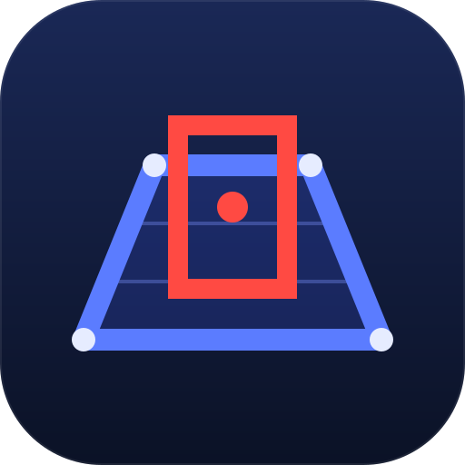
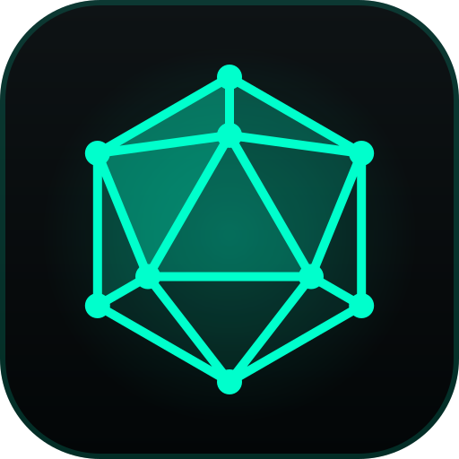
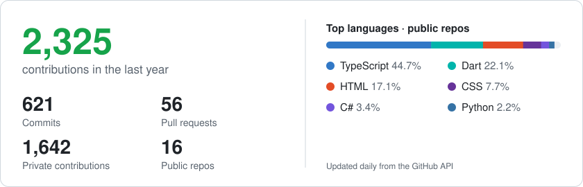

# Trupal Patel

**Software Development Engineer at Aetna (CVS Health) · member of [trueorfalse.dev](https://trueorfalse.dev)**

Georgia, USA · raised in Ahmedabad, Gujarat, India

---

## Now

I work on utilization management and care management at **Aetna**, a CVS Health company: cloud-native applications on Google Cloud, BigQuery analytics and data pipelines, GenAI prototypes, and the APIs that connect them.

Outside work I'm a member of **[True or False](https://trueorfalse.dev)**, a small software studio that builds mobile apps, web products and websites, ships them, and keeps them running.

## Studio products · [trueorfalse.dev](https://trueorfalse.dev)

| | Product | What it does | Platforms |
|:-:|---|---|---|
| | **[Skills & Agents](https://skills.trueorfalse.dev)** | A catalog of agent skills, subagents, workflows and MCP servers for Claude Code, Claude.ai, Codex and ChatGPT, with its own remote MCP server | Web · MCP |
|  | **[LogicSprint](https://logicsprint.trueorfalse.dev)** | Four quick brain games with a daily global Top 10 and no login | iOS · Android |
| | **[Family Tree](https://family.trueorfalse.dev)** | A private family tree relatives build together, with relationship names in Gujarati and English | Web |
|  | **[Contact Convoy](https://www.contactconvoy.com)** | Scan business cards; AI cleans up the fields and the team follows up on every lead | Android · Web |
|  | **[StoreDesk](https://storedesk.net)** | A local-first back office for convenience stores and gas stations that talks to the register directly | Windows · Android · Web |

Client websites: [Dr. Nandini Jansari](https://www.drnandini.com) (home-visit physiotherapy), [MeghVin Foundation](https://meghvin.vercel.app) (charitable trust) and [Nyara Melamine](https://trueorfalse.dev/websites/nyara) (houseware catalogue).

## Experience

**Software Development Engineer · Aetna (CVS Health)** · _Oct 2026 – now_
Utilization and care management on GCP: BigQuery pipelines, GenAI prototypes and REST APIs.

**Founding Software Engineer · [Allyvia](https://www.allyvia.co)** · _Jul 2025 – Apr 2026_
First engineer on a SaaS platform on Google Cloud: React 19 and TypeScript front end, Django REST APIs, BigQuery pipelines with incremental QuickBooks syncs, Pub/Sub and Cloud Storage ingestion, and RBAC. [More](https://trupalpatel.com/experience/allyvia)

**Software Engineer · AIVID.AI** · _Jan 2023 – Jun 2025_
Analytics applications and data pipelines across 200+ production sites; Elasticsearch queries about 25% faster; C# edge services and computer-vision capture tools. [More](https://trupalpatel.com/experience/aivid-ai)

**Frontend Software Engineer · InfoLabz IT Services** · _Jan 2022 – Dec 2022_
Responsive React applications with Redux state and REST integrations. [More](https://trupalpatel.com/experience/infolabz)

## Projects

Case studies are on [trupalpatel.com/projects](https://trupalpatel.com/projects).

| | Project | What it is |
|:-:|---|---|
|  | **[Web Warehouse](https://github.com/TRUPALIX9/web-warehouse)** | Inventory, purchase orders and warehouse slots with a 3D preview |
|  | **[Shipping Agent](https://github.com/Shipping-Agent/shipping-agent)** | Paste an order, get a label: carrier quotes through ShipStation and checkout to a printable label |
|  | **[RetailSync](https://github.com/comp596-spring-2026/RetailSync)** | Multi-tenant retail SaaS with POS imports, bank statements and QuickBooks (team project) |
|  | **[Fire Forecasting](https://github.com/TRUPALIX9/fire-forecasting)** | Wildfire risk dashboard prototype with a forecast map and risk charts |
|  | **[ZoneWatch](https://github.com/TRUPALIX9/Motion-Detection-Windows-App)** | Zone-based motion detection for ONVIF IP cameras with PTZ control (C#, EmguCV) |
|  | **[Gatelog](https://github.com/TRUPALIX9/Vehicle-Log-Managment-System)** | Windows installer and updater for a vehicle-log server stack |
|  | **[WebGL presentation](https://github.com/TRUPALIX9/comp-599-webgl)** | A seminar deck where every slide runs a live Three.js scene |
|  | **[File System Engine](https://github.com/TRUPALIX9/file-system-engine)** | Electron file manager with a dual-pane transfer hub and a treemap disk analyzer |

## Tech

| | |
| :--- | :--- |
| **Languages** | TypeScript, JavaScript, Python, Dart, C#, C++, SQL |
| **Front end & mobile** | React, Next.js, Angular, Flutter, Redux Toolkit, React Query, Tailwind CSS, Three.js |
| **Back end** | Node.js, Express, Django REST Framework, FastAPI, WebSockets |
| **Data** | BigQuery, PostgreSQL, MongoDB, Elasticsearch, Supabase, SQLite |
| **Cloud & delivery** | Google Cloud (BigQuery, Pub/Sub, Cloud Storage, Cloud Run, Vertex AI), AWS, Cloudflare Workers, Vercel, Docker, GitHub Actions |
| **AI** | Gemini, Vertex AI, OpenAI, Groq, MCP servers, agent skills |

Certifications: AI Mastery (Cal Poly Digital Transformation Hub), Meta Front-End Developer ([badge](https://www.credly.com/badges/8acca941-de83-466e-b754-0518b0f25e25)), Elastic Stack, AWS S3 Basics and [more](https://trupalpatel.com/certifications).

## Off the clock

A lot of series and films, logged season by season at **[trupalpatel.com/binge](https://trupalpatel.com/binge)**, with a Marvel timeline. Favourite Marvel character: Moon Knight. Suggestions welcome there.

  <picture>
    <source media="(prefers-color-scheme: dark)" srcset="assets/stats-dark.svg" />
    
  </picture>

  <a href="https://trupalpatel.com">trupalpatel.com</a> · <a href="mailto:trupal.work@gmail.com">trupal.work@gmail.com</a> · <a href="https://www.linkedin.com/in/trupalix">LinkedIn</a> · <a href="https://trueorfalse.dev">trueorfalse.dev</a>

